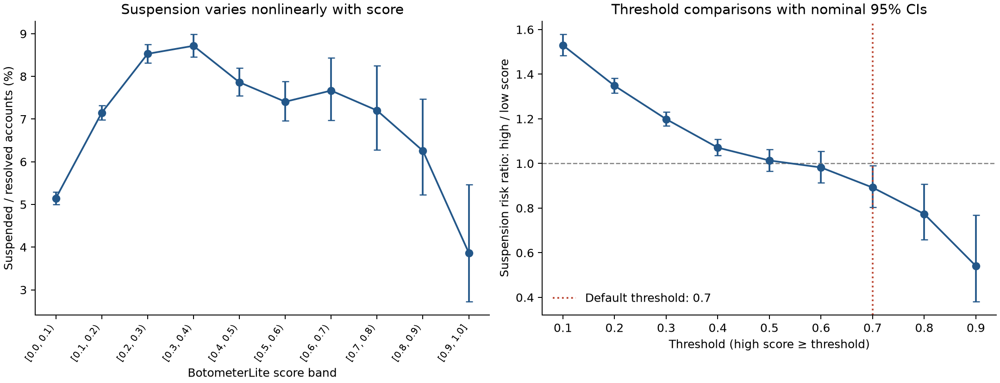
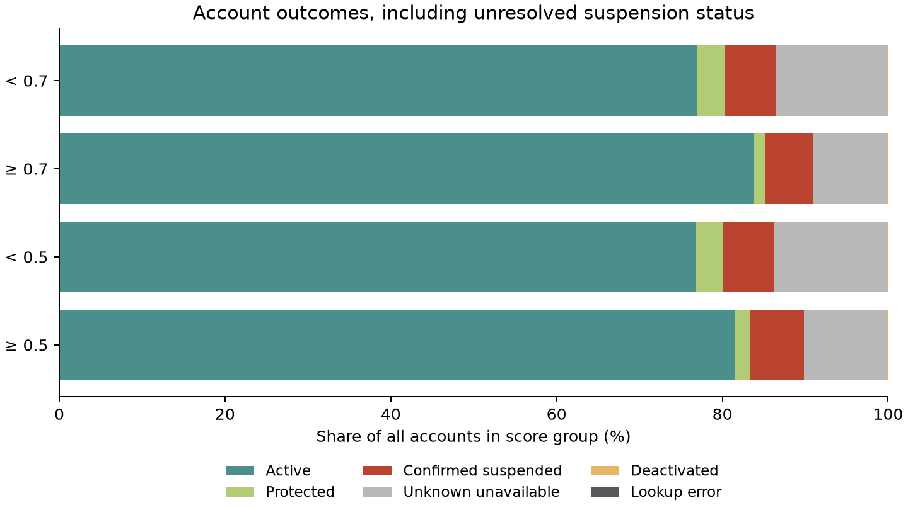

# BotometerLite scores and account suspension

Analyzed 2026-11-12 (Asia/Singapore), using the current [account_status.csv](../../data/account_status.csv). This report supersedes the preliminary bulk-only analyses.

## Finding

**The default hypothesis is not supported at score ≥0.7.** Among accounts with resolved suspension status, 333/5,218 high-score accounts (6.38%) are suspended, versus 23,531/328,957 lower-score accounts (7.15%). The risk ratio is **0.892** (95% CI 0.804–0.991): about 10.8% relatively lower, an absolute difference of -0.77 percentage points.

At **0.5**, rates are 7.23% versus 7.13%, RR 1.013 (95% CI 0.966–1.064), with no clear difference. Lower exploratory thresholds (0.1–0.4) do yield higher suspension rates in the high-score group, but the score-band curve peaks in the middle and falls in the upper tail. The evidence supports a **weak, nonlinear relationship**, rather than a general rule that more bot-like accounts are more likely to be suspended.

These conclusions apply to resolved statuses. Unknown outcomes are numerous and could change the full-dataset comparison; they are assessed below. High-score groups are score-defined classifications, not verified bot identities.

## Data and outcome definition

The CSV contains **386,327 accounts**, with unique numeric-string IDs, no missing cells, and finite scores between 0 and 1. IDs were read as strings to preserve precision. The actual score column is `botometerlite_score`.

| Current status | Accounts | Share | Mean score | Median score |
| --- | ---: | ---: | ---: | ---: |
| `active` | 297,743 | 77.07% | 0.2190 | 0.18 |
| `deactivated` | 542 | 0.14% | 0.2211 | 0.18 |
| `lookup_error` | 1 | 0.00% | 0.1200 | 0.12 |
| `protected` | 12,568 | 3.25% | 0.1858 | 0.15 |
| `suspended` | 23,864 | 6.18% | 0.2388 | 0.21 |
| `unavailable_reason_unknown` | 51,609 | 13.36% | 0.2048 | 0.17 |

The primary binary analysis uses **334,175 resolved accounts**: `suspended` is the event; `active` and `protected` are the comparison. It excludes **52,152** other accounts: 51,609 unavailable with unknown reason, one lookup error, and 542 explicitly deactivated accounts. Deactivation is a distinct outcome and is not counted as suspension. A sensitivity analysis treats deactivated accounts as non-suspended; results change negligibly.

The outcome is **suspension at the status observation**, not lifetime suspension, permanent banning, or a future suspension hazard. Active means a public profile was returned, not recent posting. Scores are historical and the CSV has no per-row score/status timestamps. Collection documentation dates the bulk and follow-up observations to 11 November 2026 in Singapore. No new lookups were made. See [status definitions](../../docs/provenance.md#status-interpretation).

## Threshold comparisons

At every threshold, high score means **score ≥ threshold**, and low score means **score < threshold**. Rates below use resolved accounts within each group; unresolved accounts are excluded from both numerator and denominator.

| Threshold | High-score suspended / resolved | High rate | Low rate | RR (95% CI) | Difference (pp) | Two-sided p | Holm p |
| --- | ---: | ---: | ---: | ---: | ---: | ---: | ---: |
| 0.1 | 19,258 / 244,662 | 7.87% | 5.15% | 1.530 (1.483–1.578) | +2.73 | 7.37e-157 | 6.63e-156 |
| 0.2 | 12,928 / 156,121 | 8.28% | 6.14% | 1.348 (1.316–1.382) | +2.14 | 7.33e-126 | 5.86e-125 |
| 0.3 | 7,541 / 92,964 | 8.11% | 6.77% | 1.199 (1.168–1.231) | +1.34 | 8.18e-42 | 5.73e-41 |
| 0.4 | 3,710 / 49,015 | 7.57% | 7.07% | 1.071 (1.035–1.108) | +0.50 | 6.62e-05 | 0.000397 |
| 0.5 | 1,647 / 22,778 | 7.23% | 7.13% | 1.013 (0.966–1.064) | +0.10 | 0.587 | 1 |
| 0.6 | 724 / 10,317 | 7.02% | 7.15% | 0.982 (0.915–1.055) | -0.13 | 0.621 | 1 |
| 0.7 | 333 / 5,218 | 6.38% | 7.15% | 0.892 (0.804–0.991) | -0.77 | 0.0326 | 0.0977 |
| 0.8 | 142 / 2,566 | 5.53% | 7.15% | 0.774 (0.659–0.908) | -1.62 | 0.0017 | 0.0068 |
| 0.9 | 30 / 776 | 3.87% | 7.15% | 0.541 (0.381–0.768) | -3.28 | 0.000599 | 0.003 |

The default 0.7 comparison has a nominal two-sided p=0.0326, in the opposite direction to the hypothesis; the one-sided p for **higher** risk is 0.984. Its risk-difference 95% CI is -1.41 to -0.07 pp, and its odds ratio is 0.885 (95% CI 0.791–0.989).

**0.7 is the prespecified primary threshold.** All other thresholds are exploratory. Holm p-values adjust the two-sided tests across all nine thresholds as a conservative sensitivity check; the default's adjusted p is 0.0977. Confidence intervals are nominal, not simultaneous. Do not pick a lower threshold because it gives a preferred result: changing the threshold changes which accounts the hypothesis describes. A cutoff of 0.1, for example, labels most resolved accounts as high-score. This dataset contains no verified bot labels with which to validate a new bot cutoff.

## Continuous score and score bands

| Score band | Resolved accounts | Suspended | Suspension rate (95% CI) |
| --- | ---: | ---: | ---: |
| [0.0, 0.1) | 89,513 | 4,606 | 5.15% (5.00%–5.29%) |
| [0.1, 0.2) | 88,541 | 6,330 | 7.15% (6.98%–7.32%) |
| [0.2, 0.3) | 63,157 | 5,387 | 8.53% (8.31%–8.75%) |
| [0.3, 0.4) | 43,949 | 3,831 | 8.72% (8.46%–8.98%) |
| [0.4, 0.5) | 26,237 | 2,063 | 7.86% (7.54%–8.19%) |
| [0.5, 0.6) | 12,461 | 923 | 7.41% (6.96%–7.88%) |
| [0.6, 0.7) | 5,099 | 391 | 7.67% (6.97%–8.43%) |
| [0.7, 0.8) | 2,652 | 191 | 7.20% (6.28%–8.25%) |
| [0.8, 0.9) | 1,790 | 112 | 6.26% (5.23%–7.48%) |
| [0.9, 1.0] | 776 | 30 | 3.87% (2.72%–5.47%) |

Bands are left-inclusive and right-exclusive, except the final band includes 1.0. Counts sum exactly to the primary analysis population.

Suspended accounts have mean score 0.2388 (median 0.21), compared with 0.2177 (median 0.18) among active/protected accounts. The point-biserial correlation is **0.0327**, and score-only ranking AUC is **0.5510** (0.5 is chance ranking). These show weak overall separation.

An unadjusted logistic regression with one linear score term gives OR **1.075 per +0.1 score** (95% CI 1.067–1.083; p=2.02e-79). This is a compact linear summary; its monotone fitted curve misses the observed middle-score peak and high-score decline. It should not be used to claim a monotonic increase. A positive average slope and lower suspension rates above 0.7 can coexist because they summarize different parts of this nonlinear curve.

## Unknown outcomes and sensitivity

The following table uses **all accounts** in each score group. Confirmed suspension share is directly observed, but it is a lower bound on a hypothetical fully resolved suspension rate, not an estimate that unknown accounts are non-suspended. Bounds conservatively allow every excluded account, including deactivations, to be suspended or non-suspended. These are identification bounds, not confidence intervals.

| Threshold | Group | All accounts | Excluded from binary outcome | Confirmed suspension share | Full-data suspension bounds |
| --- | --- | ---: | ---: | ---: | ---: |
| 0.7 | high_score | 5,734 | 516 (9.00%) | 5.81% | 5.81%–14.81% |
| 0.7 | low_score | 380,593 | 51,636 (13.57%) | 6.18% | 6.18%–19.75% |
| 0.5 | high_score | 25,350 | 2,572 (10.15%) | 6.50% | 6.50%–16.64% |
| 0.5 | low_score | 360,977 | 49,580 (13.73%) | 6.15% | 6.15%–19.89% |

- At 0.7, the unconstrained high-minus-low difference can range from **-13.94 to 8.62 pp**. If 25% of excluded low-score accounts were suspended, the hypothesis would hold if more than **41.9%** of excluded high-score accounts were suspended. This is a hypothetical tipping point, not an estimate.
- At 0.5, the unconstrained high-minus-low difference can range from **-13.39 to 10.49 pp**. If 25% of excluded low-score accounts were suspended, the hypothesis would hold if more than **30.5%** of excluded high-score accounts were suspended. This is a hypothetical tipping point, not an estimate.

At **0.7**, assigning the **same suspension proportion** to excluded accounts in each score group leaves the full-data high-score suspension rate lower for every proportion from 0% to 100%. At **0.5**, the high-score rate is slightly higher when that common proportion is below **9.5%**, equal at that point, and lower above it. Differential unknown outcomes can reverse either comparison, as the bounds show. The resolved-only comparison instead implicitly generalizes under comparable outcome distributions between resolved and excluded accounts within each group; that assumption cannot be verified from this CSV.

As denominator checks, treating deactivated accounts as non-suspended and excluding protected accounts gives:

| Threshold | Denominator | Risk ratio (95% CI) |
| --- | --- | ---: |
| 0.5 | `resolved_plus_deactivated` | 1.013 (0.966–1.063) |
| 0.5 | `active_or_suspended_only` | 0.994 (0.947–1.043) |
| 0.7 | `resolved_plus_deactivated` | 0.892 (0.803–0.990) |
| 0.7 | `active_or_suspended_only` | 0.871 (0.784–0.967) |

## Methods and interpretation

Risk-ratio CIs and p-values use the log-risk-ratio Wald approximation; odds-ratio CIs use log-Wald intervals. Rate CIs use Wilson intervals, and risk-difference CIs use Newcombe's independent-proportions method combining Wilson bounds. All selected 2×2 tables have nonzero cells; no continuity corrections were needed. AUC uses average ranks for score ties. Logistic regression is maximum likelihood with an intercept and score/0.1; its information matrix provides model-based standard errors.

Counts and rates describe this entire CSV exactly. Inferential CIs and p-values treat accounts as independent observations from a broader population; the sampling design is not provided. Shared networks, campaigns or account ownership may violate independence. Statistical significance in this large dataset does not imply strong prediction. Estimates are unadjusted: account age, activity, collection selection, and historical score accuracy could affect the association. These data cannot establish that bots cause suspension or estimate a future suspension risk.

The most useful additional evidence would be resolved outcomes for the unknown accounts and independent bot labels, plus score/observation times and relevant account covariates. Results already answer the observed comparison at 0.7; remaining unknowns limit claims about all accounts.

## Outputs and archived reproduction

All six original statistical CSV tables are available as named sheets in [tables.xlsx](tables.xlsx), alongside continuous-score metrics, validation records, collection metadata and source checksums. Values were consolidated without recalculating the analysis.

The figures are embedded above. The original vector PDF, separate CSV/JSON exports, code, dependencies and validation records are retained in the local archive. See [provenance and restoration guidance](../../docs/provenance.md#archived-evidence-and-reproduction).

Source: [the unchanged account-status dataset](../../data/account_status.csv). SHA-256: `71cd82e397445803332ecb481fe1f2dd0497f018d74369748cdf595197c2cb6f`.
