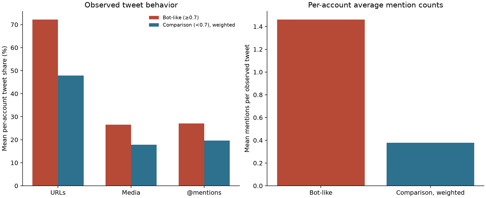
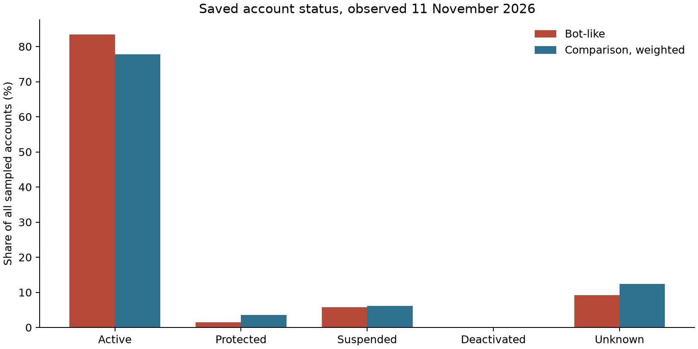
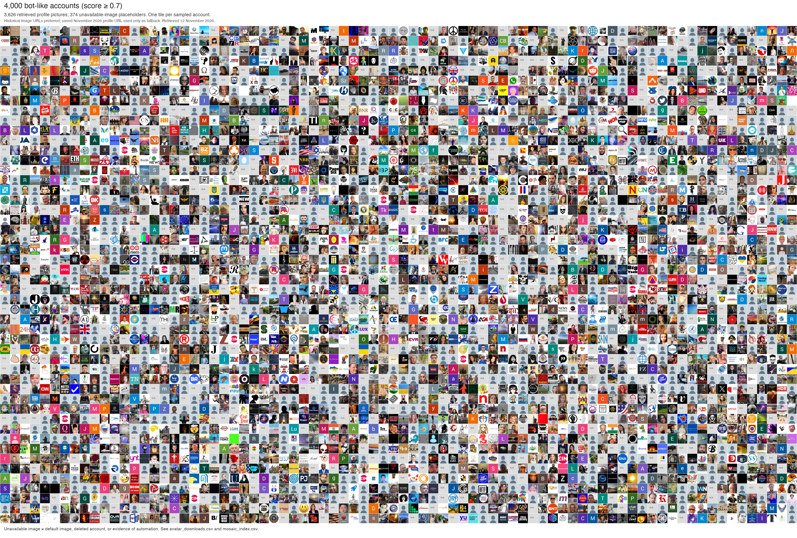
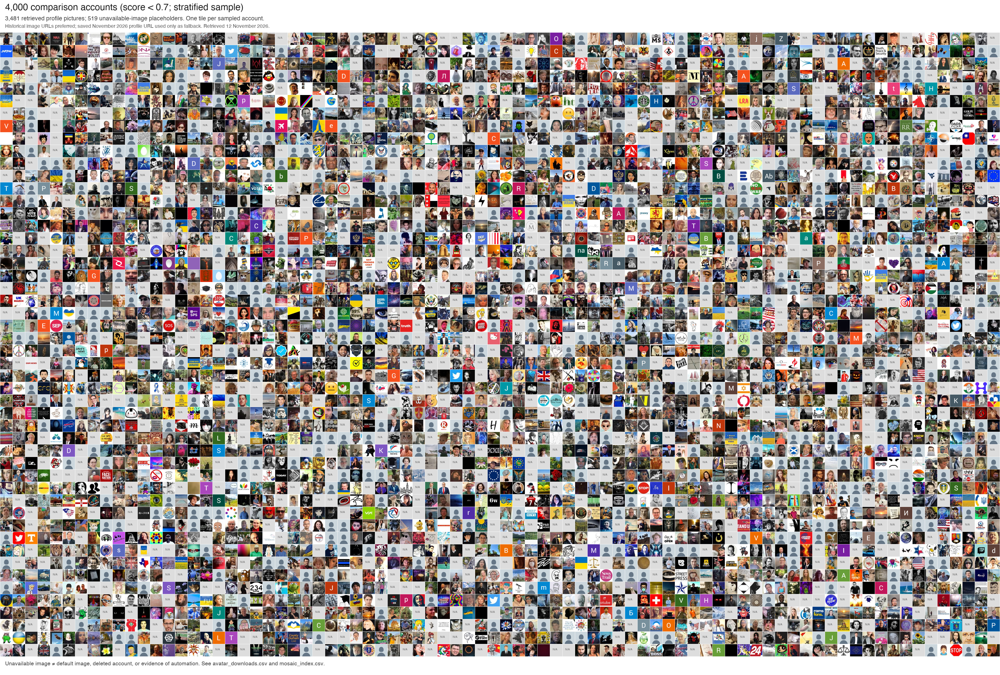

# Supplementary validation of bot-like Twitter accounts

Analysis date: 12 November 2026 (Asia/Singapore). Classification follows the original kc score file: **bot-like ≥0.7**, **comparison <0.7**. Comparison accounts are not independently verified humans.

## Sampling and deliverables

We sampled **4,000 bot-like and 4,000 comparison accounts**. The eligible frame contains 386,327 accounts, including 5,734 bot-like accounts. Bot-like accounts were sampled uniformly without replacement. Comparison accounts were sampled nearly equally across seven 0.1 score intervals below 0.7 (571 or 572 per interval), using random seed 20261112.

Classification, recorded handles and score timestamps come from `Ukriane_bot_scores_unique_handles_kc.csv`. Exact IDs come from the previously audited recovered-ID mapping, used only for linkage. The frame excludes 2,809 unresolved IDs and all six ambiguous duplicate-handle records; exclusion details are preserved. This is a complete-case identity frame, not every original score-file row.

**Comparison means below use design weights N_h/n_h**, restoring the eligible population distribution below 0.7. Unweighted comparison means, stratum results and weights are also provided. Equal allocation without weighting would substantially change the baseline.

- [Excel workbook](supplementary_validation.xlsx): 8,000 account rows, summaries, sampling design and column definitions.
- [Account CSV](sampled_accounts.csv), [comparison statistics and score-stratum statistics](supplementary_validation.xlsx) (the `Group comparison` and `Score strata` sheets).
- [Bot-like profile mosaic](bot_like_profile_mosaic.jpg) and [comparison profile mosaic](comparison_profile_mosaic.jpg): each has one position for each sampled account, including labeled failed-download positions.

## Tweet behavior: independent of the published Lite profile inputs

These are **means of per-account measures**: each account contributes equally within its population stratum. URL and media presence mean positive evidence in the exported tweet fields; absence of evidence is not a guarantee that the original platform record lacked it. Retweets are included, so these measure material shared by an account, not necessarily material authored by it.

**Retweet reconstruction is essential here:** many raw retweet records contain truncated text and blank URL/media fields, while the full post is embedded in `referenced_tweets`. For native retweets, primary URL, media and mention measures use the top-level retweeted post only; mentions exclude the synthetic `RT @author` attribution. Replies and quotes do not inherit unrelated parent-post fields. Failed reconstruction is missing, not absence. Raw-export versions are preserved as sensitivity measures.

| Measure | Bot-like | Comparison, weighted | Difference (95% CI) | Holm p, four primary measures |
| --- | ---: | ---: | ---: | ---: |
| Share of observed tweets with URL evidence | 72.23% | 47.90% | +24.335 (+22.468 to +26.201) pp | 1.6e-143 |
| Share of observed tweets with media evidence | 26.56% | 17.84% | +8.724 (+7.236 to +10.211) pp | 2.88e-30 |
| Share of observed tweets with @mentions | 27.09% | 19.65% | +7.438 (+5.913 to +8.962) pp | 1.15e-21 |
| Mean @mentions per observed tweet | 1.462 | 0.378 | +1.084 (+1.005 to +1.164) | 1.21e-156 |

The `Tweet pooled` sheet in the [workbook](supplementary_validation.xlsx) gives weighted pooled tweet rates. Those estimates give more influence to prolific accounts and answer a different question.

### Retweet composition and export sensitivity

Bot-like accounts and comparison accounts may share different mixtures of retweets versus non-retweets. The following conditional comparisons separate those contexts. They describe accounts with at least one usable tweet of that type and therefore are different observed domains, not a matched causal comparison.

| Measure | Bot-like | Comparison, weighted | Known accounts, bot / comparison |
| --- | ---: | ---: | ---: |
| Raw export URL share before retweet reconstruction | 42.82% | 14.81% | 4,000 / 4,000 |
| Raw export media share before retweet reconstruction | 6.12% | 1.94% | 4,000 / 4,000 |
| Raw export mention share, including RT attribution | 59.24% | 89.71% | 4,000 / 4,000 |
| URL share within non-retweet posts | 68.47% | 44.76% | 2,336 / 1,161 |
| Media share within non-retweet posts | 9.88% | 5.01% | 2,336 / 1,161 |
| Mention share within non-retweet posts | 28.28% | 52.34% | 2,336 / 1,161 |
| Mentions per non-retweet post | 0.460 | 1.046 | 2,336 / 1,161 |
| URL share within reconstructed retweets | 76.96% | 49.66% | 1,787 / 3,052 |
| Media share within reconstructed retweets | 47.57% | 21.52% | 1,787 / 3,052 |
| Mention share within reconstructed retweets | 25.72% | 10.43% | 1,787 / 3,052 |
| Mentions per reconstructed retweet | 2.703 | 0.189 | 1,787 / 3,052 |

## Network and profile descriptions

**These comparisons are descriptive, not independent validation.** Followers, following, their ratio, handle morphology/randomness and default profile settings overlap the published BotometerLite inputs. A difference is expected from score-based selection and cannot establish that classification is accurate. Default image is a related profile characteristic, reported separately from default settings. [Published model feature list, Table 1](https://arxiv.org/html/1911.09179v1).

| Measure | Bot-like | Comparison, weighted | Known observations, bot / comparison |
| --- | ---: | ---: | ---: |
| Followers in historical profile record | 1,565.199 | 3,906.249 | 4,000 / 4,000 |
| Following in historical profile record | 1,683.419 | 1,676.337 | 4,000 / 4,000 |
| Historical follower/following ratio (following > 0) | 25.295 | 6.784 | 3,565 / 3,942 |
| Followers < 100 and following >= 1000 (illustrative rule) | 6.75% | 0.97% | 4,000 / 4,000 |
| Recorded handles containing letters and numbers | 46.18% | 36.48% | 4,000 / 4,000 |
| Recorded handles ending in at least four digits | 18.55% | 11.31% | 4,000 / 4,000 |
| Default profile setting, among returned profiles with flag | 90.29% | 71.63% | 3,397 / 3,282 |
| Default profile image, among returned profiles with flag | 15.72% | 5.60% | 3,397 / 3,282 |
| Historical image URL explicitly points to default image | 16.05% | 5.90% | 3,999 / 3,999 |
| Historical bio matches automation keywords (heuristic) | 0.83% | 0.18% | 4,000 / 4,000 |

Follower/following counts come from the profile attached to each account’s latest observed historical tweet record. The tweet timestamp does not establish when profile metadata was collected. Ratios are undefined when following=0 and remain missing; the spreadsheet includes a separate zero-following flag. Skewed means should be read with weighted medians in the comparison table.
For example, the mean follower/following ratio is 25.30 versus 6.78, but the medians are **0.163 versus 0.493**. The high bot-like mean is driven by extreme ratios and is not typical of that group.

The trailing-four-digit flag is an illustrative reproducible pattern, not a finding that a handle is randomly generated. A biography keyword flag may match benign bots, jokes or negations and does not label spam or impersonation. No such verdicts were inferred.

## Account status

**The user requested reuse of the saved 11 November observations.** No new profile-page audit or paid API requests were made. The workbook records the ID-based evidence path, exact UTC time, Singapore time and observation date for every sampled account. A public profile means accessible, not recently posting.

| Status | Bot-like | Comparison, weighted |
| --- | ---: | ---: |
| public profile returned | 83.50% | 77.78% |
| protected | 1.43% | 3.57% |
| confirmed suspended | 5.75% | 6.09% |
| explicitly deactivated | 0.18% | 0.14% |
| unknown unavailability or lookup error | 9.15% | 12.42% |

Unavailable accounts are not labeled deleted; explicit deactivation is separate from unknown unavailability. Current returned handles are compared with the historical score-file handles, but redirects were not tested. Recent inactivity cannot be established from a topic-filtered 2021–2022 tweet collection or a profile-only status response. The account sheet marks those fields not assessed.

## What does this say about automation?

URL use, media use and mentions provide independent behavioral descriptions, but none is specific to automation: people and organizations also share links, media and mentions. We do not define higher use of every feature as inherently more bot-like. The four outcomes were fixed before inspecting group comparisons and are reported regardless of direction.

Observed independent differences: URL share is **72.23% versus 47.90%**, media share **26.56% versus 17.84%**, and content-mention share **27.09% versus 19.65%** (bot-like versus weighted comparison). These differences characterize shared-content behavior; they do not by themselves identify automated operation.

This study can show whether score-defined groups behave differently, but **cannot estimate bot-classification precision, recall, or probability calibration** without independently known automation outcomes. A positive difference in a model-input feature is not used to support validity.

Original-text repetition is included as an exploratory check only for accounts with at least five original posts; lower-coverage accounts are missing, not assigned zero. No coordination verdict is inferred merely from sharing the same popular retweet. A defensible coordination study needs repeated synchronized actions and a baseline preserving account activity, content popularity and news-event timing.

Coverage is limited:

| Group | Observed tweets | Accounts with one tweet | Accounts with ≥5 tweets |
| --- | ---: | ---: | ---: |
| bot_like | 12,168 | 2,672 | 435 |
| comparison | 9,945 | 2,692 | 405 |

The exploratory repeated-original-text share is 4.46% versus 3.91%, based on just 250 and 61 qualifying accounts. Its difference CI (-2.42 to 3.53 pp) does not show clear separation. This limited check does not validate repetitive automation.

These are raw sample counts, not population estimates. Sparse observations prevent reliable individual conclusions about repetitive posting, sleep cycles or posting regularity. The original score timestamps (2020–2023) and current status observations (2026) also describe different times.

## Statistical methods and reproduction

Group means use Horvitz–Thompson weights with a Hájek ratio for observed/nonmissing values. Standard errors use independent simple-random sampling without replacement within score strata, finite-population corrections, and a linearized ratio variance for missing-value domains. Differences combine the independent group variances; CIs are normal-approximation 95% intervals. Holm adjustment covers the four primary behavioral comparisons. No independence between tweets of the same account is assumed: the sampling and analysis unit is the account. Missing-domain estimates describe the observed domain and do not correct outcome-dependent missingness.

Intervals quantify account-sampling uncertainty within this eligible dataset, not uncertainty from the platform collection process, score errors, or broader-population generalization. Statistical differences alone do not establish meaningful predictive validity.

The original scripts, dependencies, intermediate exports, sampling manifest and validation records are preserved in the gitignored local archive. See [archived evidence and reproduction](../../docs/provenance.md#archived-evidence-and-reproduction). No analyses were rerun during cleanup.

Recorded source/evidence/image-cache paths inside the unchanged workbook and account CSV refer to the original layout inside the archive. They are provenance references, not live paths. Mosaic row/column positions and image retrieval outcomes remain in the account sheet.

## Profile picture mosaics

Each mosaic contains 4,000 sampled-account positions. Successfully retrieved pictures: **3,626 bot-like** and **3,481 comparison**. Gray N/A tiles represent retrieval failures or missing URLs; they are distinct from genuine default avatars. Historical URLs are preferred; newer saved profile URLs are fallback images, identified per account in the spreadsheet. The balanced-strata comparison mosaic visualizes the raw sample, not the population-weighted comparison distribution.

